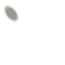
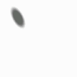
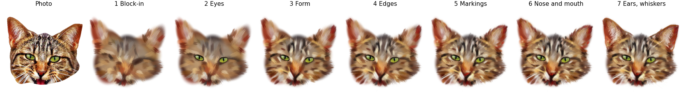
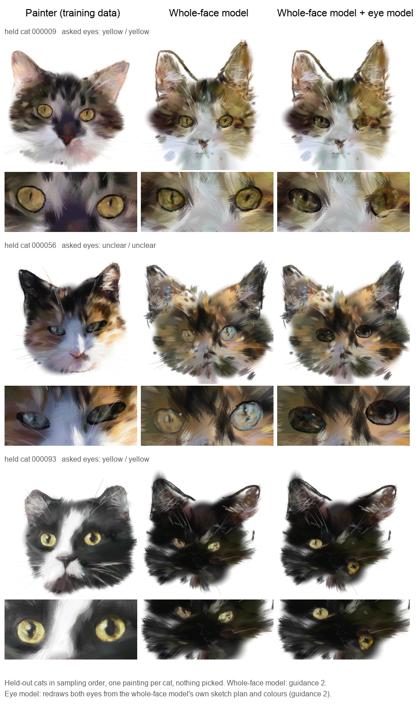
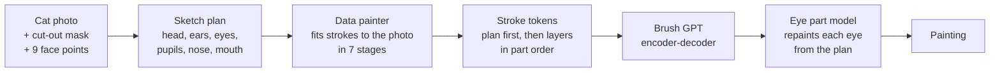
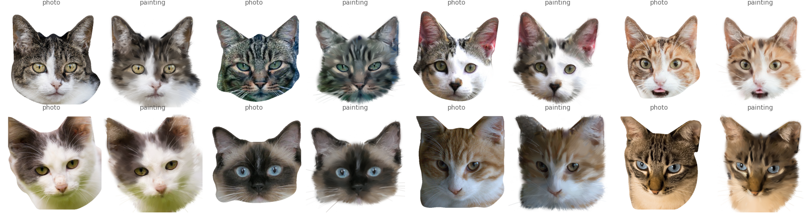

# Brush GPT

[](https://github.com/alina0607/brush-gpt/actions/workflows/ci.yml)

<div align="center">
  
  
</div>

*Brush GPT painting cats stroke by stroke (whole-face model, then the eye part model; asked: yellow eyes, grey tabby coat). Samples #32 and #44 were chosen by hand from 48 samples for this preview; the results below use one sample per cat, nothing picked.*

> A transformer that paints cat portraits one brush stroke at a time. It is trained on 6,000+ paintings made by a
> stroke-fitting "data painter" that turns cat photos into layered digital paintings, and it is conditioned on what
> the cat should look like (coat colour, pattern, each eye's colour). Built from scratch in PyTorch.



Brush GPT draws the cats of [Sell Anything](https://github.com/alina0607/BidGPT), a game where the player
names a cat ("a calico with one green and one copper eye") and watches it being painted. Pixel generators can make
pretty images, but they cannot be watched stroke by stroke, cannot be edited one part at a time, and do not paint the
way a person does. Brush GPT writes a painting the way a painter works: a sketch first, then the big shapes, then the
eyes, the fur and the whiskers, each stroke a token with a position, size, angle, colour and opacity.

| | |
|---|---|
| **Task** | Conditional generation of stroke sequences (5,500-8,800 tokens per painting, median 7,600) |
| **Models** | Encoder-decoder transformer, 33.1 M parameters (whole face); decoder-only GPT, 19.1 M parameters (eyes) |
| **Data** | 6,024 paintings fitted to photos from AFHQ and the CAT dataset; 4,705 whole-face cats (688 held out) |
| **Techniques** | Stroke-based rendering by gradient descent, condition dropout with classifier-free guidance, a learned part model in a cascade, grammar-constrained sampling, RoPE, SwiGLU, RMSNorm, KV cache |
| **Compute** | Apple M-series GPU for the painter; single NVIDIA T4 / A100 for training |

## Results

All numbers are on **held-out cats** (never seen in training), one sample per cat, nothing picked. A painting
"reads right" when an independent colour reader, which measures each painted iris and coat in CIELAB and names it,
agrees with the colour that was asked for.



**Whole-face model** (32 held cats; guidance strength g):

| Asked attribute read right | Data painter | Model, g = 1 | Model, g = 2 | Model, g = 3 |
|---|---|---|---|---|
| Left eye colour | 27/27 | 4/27 | **12/27** | 5/27 |
| Right eye colour | 25/27 | 6/27 | 8/27 | **9/27** |
| Coat base colour | 23/25 | 18/25 | **22/25** | 19/25 |
| Coat pattern | 21/25 | 9/25 | 12/25 | **17/25** |

Classifier-free guidance is what makes the model follow the condition: without it the coat is often right but the
eyes are close to chance. The eyes were the weakest part, which motivated the eye part model.

**Eye part model** (27 held cats, 54 eyes; eye model at g = 2):

| | Whole-face model alone | Whole-face + eye model | Data painter |
|---|---|---|---|
| Eye colour read right (whole-face g = 1) | 10/54 | **24/54** | 53/54 |
| Eye colour read right (whole-face g = 2) | 20/54 | **25/54** | 53/54 |
| Pupil contrast (darker pupil = higher) | 0.05-0.07 | **0.15-0.17** | 0.24 |
| Share of iris strokes inside the eye outline | 0.74-0.76 | **0.83-0.85** | 0.91 |

Given a correct sketch (the painter's own eye outlines), the eye model alone reads right on 50/54 eyes, close to the
painter's 53/54. Asked to make every eye blue, 40/64 eyes read blue (the painter's originals: 3/64), so the model
follows the condition rather than copying a typical eye. **The models are not yet as good as the data painter**: most
of the remaining gap comes from the whole-face model's own sketch (eyes placed or shaped wrongly), not from the eye
model. The whole comparison, six cats in sampling order, is in
[`docs/figures/model_comparison_6cats.png`](docs/figures/model_comparison_6cats.png).

## How it works



### 1. A sketch before the paint

A painter decides the angle of the head and draws the outlines before painting. The **sketch plan** does the same
from the photo and nine face points: the head pose (yaw, pitch and roll against a mean 3D cat head recovered from
6,000 cats by Tomasi-Kanade factorisation), the outline of the head and ears, each eye's outline and pupil
(Segment Anything prompted at the eye), the nose and the mouth. In the token sequence the plan comes first (about
300 tokens), so every later stroke can follow it.

### 2. The data painter

No dataset of cat paintings stroke by stroke exists, so the training data is made by a **painter that fits brush
strokes to a photo by gradient descent** (in the spirit of stroke-based rendering; Huang et al., 2019; Liu et al.,
2021). Each stroke is a parametric brush stamp (stick, wet, drag, pencil, liner, dot, rake, whisker) whose position, size,
angle, colour and opacity are optimised against the photo with an L1 loss, in the order of a digital painting
tutorial: block-in, eyes, form, edges, markings, nose and mouth, ears and whiskers.



Two design choices make the paintings usable as training data:

- **The eyes are painted apart.** The stages after the eyes never read the photo inside them, so the same painting can
  be repainted with any eye colour by changing only the eye strokes. This gives before/after pairs for learning edits
  and lets the eyes be learned as one piece.
- **Every stroke is replayable.** Each stage's strokes are saved with their parameters; replaying them reproduces the
  canvas exactly, which is checked for every cat painted on a remote GPU.

### 3. Paintings as tokens

A painting becomes one sequence: the attributes go to the encoder; the decoder writes the sketch plan, then each layer's
strokes as fixed-field tokens (x, y, angle, size, colour and opacity). Layers are written in **part order** (the eye
layers right after the eye outlines, the ear layers around each ear), and **fur strokes use a 16-colour palette**
chosen per painting, while eye strokes keep their exact colour so eye colour is never rounded away. A grammar
restricts sampling to well-formed strokes.

### 4. Brush GPT, the whole-face model

An encoder-decoder transformer (4 encoder and 3 decoder layers with cross-attention, d = 512, 8 heads, RoPE, SwiGLU,
RMSNorm; 33.1 M parameters). The condition is dropped for 15% of training paintings, so at sampling time the model
can be pushed towards the condition with **classifier-free guidance** (Ho and Salimans, 2022): the next-token
logits are `uncond + g * (cond - uncond)`.

### 5. The eye part model

Small parts such as the iris and pupil get few tokens in a 7,600-token painting. A second, **decoder-only GPT
(19.1 M parameters) repaints each eye in an eye-centred frame**: it reads the side, the asked colour, the eye's size,
the surrounding paint colour and the sketch's eye outline and pupil, then writes the eye's six layers (base, iris,
lid shadow, pupil, lid line, highlights). It is trained on 24,224 eyes from 4,571 cats (29,704 eyes from 5,555 cats in all, with validation and held-out cats), mirrored left-right, and at
sampling time it sees only what the whole-face model produced, never the photo. It is a learned stage in a cascade,
like the super-resolution stages of cascaded diffusion models, and its results are always reported both alone and
inside the whole system.

## Limitations and next steps

- The whole-face model's own sketch is the main source of error: in about a quarter of its eyes the pupil falls outside
  the eye outline (the painter: 1 in 64). Planned: train the eye model with noise added to its sketch input
  (conditioning augmentation, as in cascaded diffusion), and a dedicated sketch model.
- The eye model overfits after about 4,000 steps on 24,000 eyes; more painted cats are being added.
- Ears drawn by the model land outside the head more often than the painter's (12-22% of ear strokes at g = 1, against 0.5-5% for the painter).

## Repository layout

| Path | What it does |
|---|---|
| `brushgpt/plan.py` | The sketch plan: head pose from a mean 3D head, head and ear outline, SAM eye and nose outlines, pupils, mouth |
| `brushgpt/brushes.py` | Stroke parameters, the eight brush kinds, windowed compositing, rendering a painting |
| `brushgpt/fur.py` | The fur direction field the strokes follow |
| `brushgpt/cat.py` | The prepared cat the painter reads: the cut-out photo, face points, head outline and zones from the plan |
| `brushgpt/painter.py` | The seven-stage data painter, the eyes painted apart, eye-colour versions, saving and replaying |
| `brushgpt/tokens.py` | The vocabulary; paintings to tokens and back (plan, part order, fur palette) |
| `brushgpt/attributes.py` | Attribute conditions and the independent colour readers used as the judge |
| `brushgpt/dataset.py` | Building the whole-face training data (split, mirrors, eye versions) |
| `brushgpt/layers.py` | Transformer building blocks (RMSNorm, SwiGLU, RoPE, attention with KV cache) and the decoder-only GPT |
| `brushgpt/model.py` | Brush GPT (encoder-decoder), its loss, and grammar-constrained guided sampling |
| `brushgpt/train.py` | Training loop and held-out sampling for Brush GPT |
| `brushgpt/eye_data.py`, `eye_model.py` | The eye part model: eye-centred data, training and guided sampling |
| `brushgpt/evaluate.py` | The measures in this README: attributes read right, eye geometry, contact sheets |
| `scripts/` | One command-line entry point per step (below) |
| `tests/` | Unit tests, and equivalence tests against the original research code |

## Quick start

```bash
uv sync                            # add "--extra plan" for the sketch plan (Segment Anything via transformers)
uv run pytest                      # unit tests; the equivalence tests skip without the original code
```

The pipeline, one script per step (each has `--help`). `cats.csv` lists each cat's name and its input files.

```bash
python scripts/plan.py --list cats.csv --out runs/plans                    # sketch plans
python scripts/paint.py --list cats.csv --out runs/paint --device cuda     # the data painter
python scripts/build_data.py --cats cats.csv --paintings runs/paint --coat-labels coat.jsonl \
    --plan --part-order --palette --mirror --out data/gen                  # tokens for Brush GPT
python scripts/train.py --data data/gen/data.npz --out runs/gen --steps 12000 --dropout 0.1 --cond-drop 0.15 --balance-cats
python scripts/sample.py --ckpt runs/gen/best.pt --data data/gen/data.npz --out runs/gen/gen_g2.npz --cats 32 --guidance 2
python scripts/build_eye_data.py --cats cats.csv --paintings runs/paint --out data/eyes
python scripts/train_eyes.py --data data/eyes/data.npz --out runs/eyes
python scripts/evaluate.py system runs/gen/gen_g2.npz --whole-data data/gen/data.npz --eye-data data/eyes/data.npz \
    --ckpt runs/eyes/best.pt --cats cats.csv
```

**Inputs.** Each cat starts as a cut-out `.npz` (the photo cropped to the head at 256 px, a trimap of cat / background /
uncertain, and nine face points) plus the original photo. The face points come from
[cat-face-landmarks](https://github.com/alina0607/cat-face-landmarks); the cut-outs, the coat labels and the
eye-colour versions are made by preprocessing code that stays in the game's repository and is not part of this one.
The coat reader needs CLIP (`openai/clip-vit-base-patch32`) and the sketch plan needs SAM (`facebook/sam-vit-base`),
both downloaded from Hugging Face on first use.

**Testing.** Every module was ported from the research code it was developed in, and each has equivalence tests that
check the port against that code on real cats: identical strokes, tokens, data files, logits, sampled tokens and
training steps; the evaluation reproduces the eye-model numbers and the whole-face column at g = 2 exactly. They run when
`SELL_ANYTHING_ML` points to that code and skip otherwise.

## Development

Python 3.10 or newer, managed with [uv](https://docs.astral.sh/uv/). `uv sync` creates the environment from
`uv.lock`, including the development tools:

```bash
uv sync
uv run ruff format --check .         # formatting
uv run ruff check .                  # lint
uv run mypy brushgpt scripts tests   # type check
uv run pytest                        # tests
```

`uv run pre-commit install` runs the same checks, except the tests, before every commit (pre-commit needs
Python 3.11 or newer).

GitHub Actions runs the four checks on every push and pull request
([`.github/workflows/ci.yml`](.github/workflows/ci.yml)). On Linux the CPU build of PyTorch is installed, so CI does
not download the CUDA libraries.

## References

- J. Ho, T. Salimans. *Classifier-Free Diffusion Guidance.* NeurIPS Workshop 2021 (arXiv:2207.12598).
- J. Ho, C. Saharia, W. Chan, D. Fleet, M. Norouzi, T. Salimans. *Cascaded Diffusion Models for High Fidelity Image Generation.* JMLR 2022.
- Z. Huang, W. Heng, S. Zhou. *Learning to Paint With Model-based Deep Reinforcement Learning.* ICCV 2019.
- S. Liu et al. *Paint Transformer: Feed Forward Neural Painting with Stroke Prediction.* ICCV 2021.
- A. Kirillov et al. *Segment Anything.* ICCV 2023.
- C. Tomasi, T. Kanade. *Shape and Motion from Image Streams under Orthography: a Factorization Method.* IJCV 1992.
- A. Vaswani et al. *Attention Is All You Need.* NeurIPS 2017.
- J. Su et al. *RoFormer: Enhanced Transformer with Rotary Position Embedding.* 2021.
- N. Shazeer. *GLU Variants Improve Transformer.* 2020.
- B. Zhang, R. Sennrich. *Root Mean Square Layer Normalization.* NeurIPS 2019.
- Y. Choi, Y. Uh, J. Yoo, J.-W. Ha. *StarGAN v2: Diverse Image Synthesis for Multiple Domains.* CVPR 2020 (AFHQ).
- W. Zhang, J. Sun, X. Tang. *Cat Head Detection.* ECCV 2008 (the CAT dataset).

## Data and licenses

No photos or datasets are redistributed. AFHQ is released under CC BY-NC 4.0 and the CAT dataset is for research use
only; both are downloaded from their original sources. The figures above show AFHQ cats and paintings derived from
them for non-commercial illustration.
